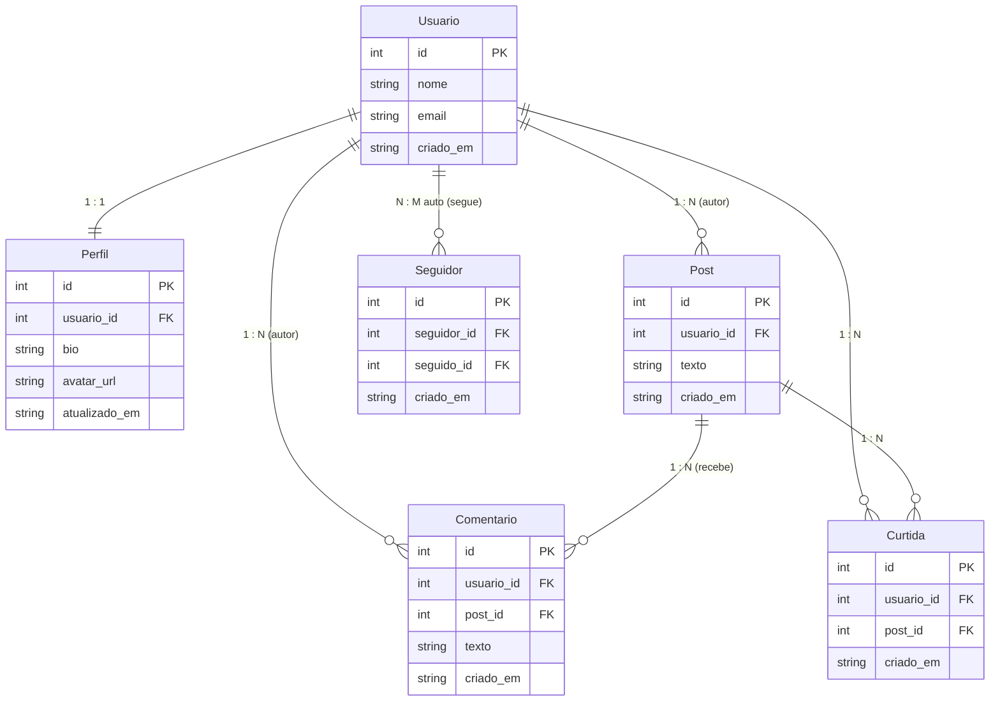

# Atividade 02 - APIs e Protocolos de Comunicação

Projeto desenvolvido para a disciplina de Tópicos Especiais em Engenharia de Software.

O objetivo da atividade é expor o mesmo domínio de uma **Rede Social Simplificada** através de dois protocolos distintos (**REST** e **GraphQL**) e analisar na prática as diferenças arquiteturais entre eles.

---

## Estrutura do Repositório

Seguindo a organização solicitada na disciplina, cada protocolo possui sua própria pasta independente com código e documentação específica:

```text
atividade-02-apis-protocolos/
├── README.md               # Visão geral, domínio e comparação final
├── requirements.txt        # Dependências gerais
├── rest-json/              # Projeto do protocolo REST
│   ├── app.py              # Servidor FastAPI REST (porta 8000)
│   ├── banco.py            # Camada de domínio e dados em memória
│   ├── test_rest.py        # Testes das operações REST
│   ├── requirements.txt    # Dependências do REST
│   └── README.md           # Exemplos copiáveis e instruções do REST
└── graphql/                # Projeto do protocolo GraphQL
    ├── app.py              # Servidor GraphQL com Strawberry (porta 8001)
    ├── banco.py            # Camada de domínio e dados em memória
    ├── test_graphql.py     # Testes das operações GraphQL
    ├── requirements.txt    # Dependências do GraphQL
    └── README.md           # Exemplos copiáveis e instruções do GraphQL
```

---

## Modelo de Domínio

O domínio contempla as 6 entidades especificadas para a rede social:
- **Usuario**: id, nome, email, criado_em.
- **Perfil**: id, usuario_id, bio, avatar_url, atualizado_em (relação 1:1 com Usuario).
- **Post**: id, usuario_id, texto, criado_em (relação 1:N com Usuario).
- **Comentario**: id, usuario_id, post_id, texto, criado_em (relação N:M com atributo).
- **Curtida**: id, usuario_id, post_id, criado_em (relação N:M pura).
- **Seguidor**: id, seguidor_id, seguido_id, criado_em (relação N:M reflexiva/auto).



---

## O que cada protocolo faz melhor que o outro nesse domínio

- **O que o REST faz melhor que o GraphQL:**  
  O REST aproveita nativamente o cache HTTP da Web em recursos identificáveis por URL (`/usuarios/1`, `/posts/1`) e oferece integração universal simples por meio de verbos e códigos de status HTTP conhecidos, sem exigir bibliotecas especiais ou parsing de query no cliente.

- **O que o GraphQL faz melhor que o REST:**  
  O GraphQL resolve o problema de under-fetching ao permitir recuperar a árvore de dados completa de uma publicação (post, autor, comentários, curtidas e contadores) em uma única requisição declarativa, sem trafegar campos excedentes (evitando over-fetching).

---

## Como Executar

### 1. Pré-requisitos
- Python 3.10 ou superior
- pip

### 2. Instalação Geral
```bash
pip install -r requirements.txt
```

### 3. Executando o REST
```bash
cd rest-json
python app.py
```
Disponível em `http://localhost:8000` (Swagger UI em `/docs`).  
Exemplos de chamadas e documentação detalhada em [`rest-json/README.md`](rest-json/README.md).

### 4. Executando o GraphQL
```bash
cd graphql
python app.py
```
Disponível em `http://localhost:8001` (GraphiQL Playground em `/graphql`).  
Exemplos de chamadas e documentação detalhada em [`graphql/README.md`](graphql/README.md).

---

## Comparação Final: REST vs GraphQL

| Critério | REST (JSON) | GraphQL (Strawberry) |
| :--- | :--- | :--- |
| **Ponto de entrada** | Múltiplas rotas (`/usuarios`, `/posts`, etc.) | Ponto de entrada único (`POST /graphql`) |
| **Controle do payload** | Fixo pelo servidor | Declarado pelo cliente em cada requisição |
| **Over-fetching** | Frequente quando a tela precisa de poucos campos | Eliminado: o cliente lista os campos que quer |
| **Under-fetching** | Frequente para relações (exige várias idas ao servidor) | Eliminado: o cliente aninha os nós no grafo |
| **Tratamento de erros** | Códigos de status HTTP semânticos (200, 201, 400, 404) | Quase sempre HTTP 200 com array `errors` |
| **Caching** | Direto e nativo via cabeçalhos HTTP e CDNs | Requer controle na camada de aplicação |
| **Contrato** | OpenAPI / Swagger | Schema SDL fortemente tipado |

### Análise Prática no Domínio da Rede Social

1. **Montagem do Feed e Detalhe do Post:**  
   Em uma rede social, um post raramente é exibido isolado: precisa do nome do autor, foto de perfil, lista de comentários e contagem de curtidas.  
   - No **REST**, ou criamos múltiplos endpoints (`GET /posts/1`, `GET /posts/1/comentarios`, etc.) gerando várias viagens de rede, ou criamos um endpoint monolítico engessado.  
   - No **GraphQL**, uma única chamada resolve o grafo completo com os campos desejados por cada tela (versão mobile resumida vs versão web completa).

2. **Diagnóstico e Infraestrutura:**  
   - O **REST** facilita o trabalho de proxies, API gateways e ferramentas de monitoramento porque falhas de cliente (`400`, `404`) são imediatamente visíveis no status HTTP.  
   - No **GraphQL**, erros retornam com HTTP 200 na camada de transporte, o que exige inspeção do corpo da resposta para detectar falhas de negócio.

3. **Quando usar cada um:**  
   - Escolha **REST** para APIs públicas consumidas por clientes heterogêneos de terceiros, microsserviços simples e cenários onde o cache de borda (CDN) é indispensável.  
   - Escolha **GraphQL** para aplicações com interfaces ricas (Web e Mobile), dados altamente relacionados e equipes de frontend que precisam de agilidade para compor telas sem depender de alterações no backend.
